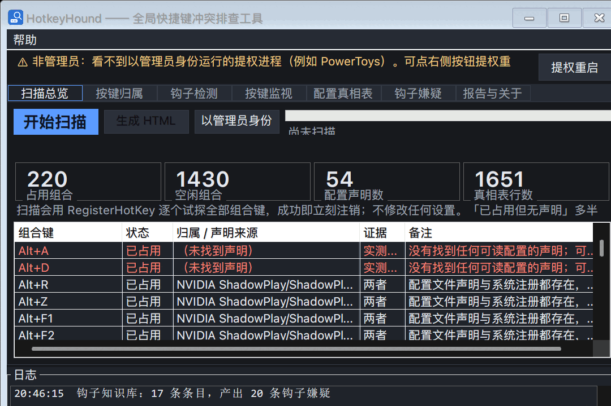
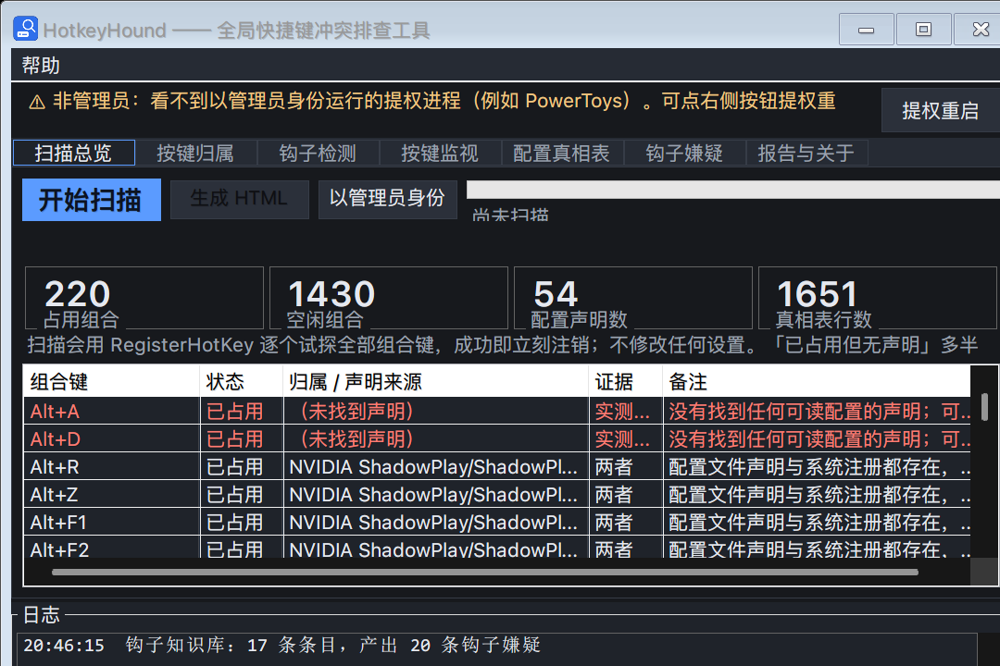
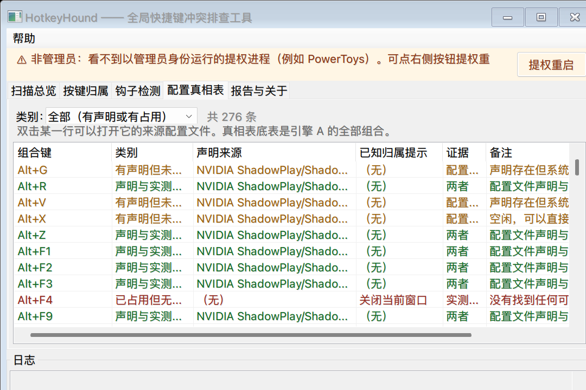
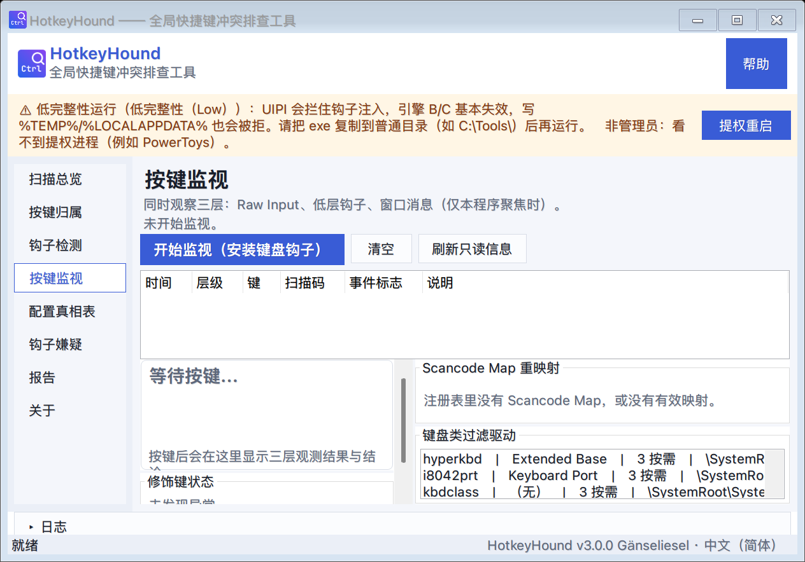
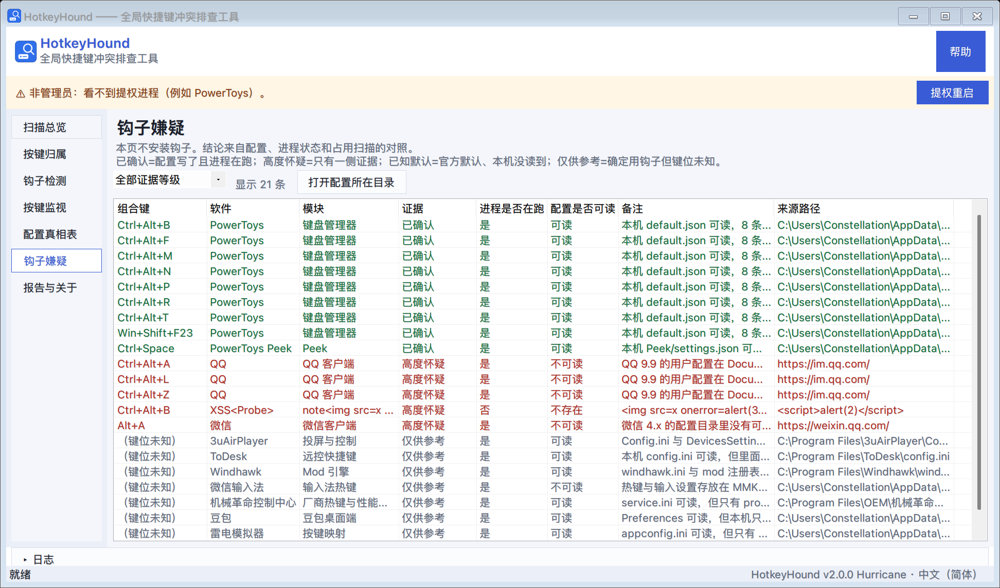
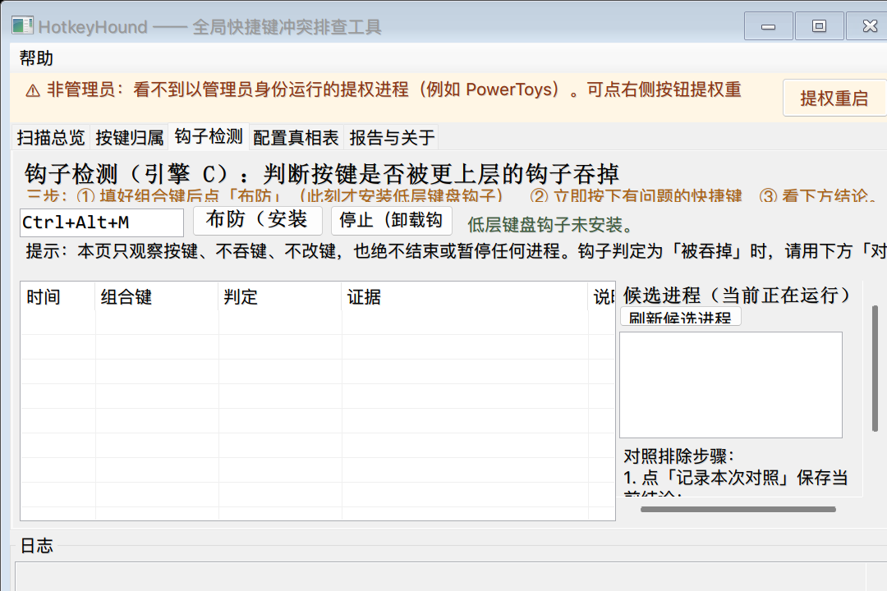
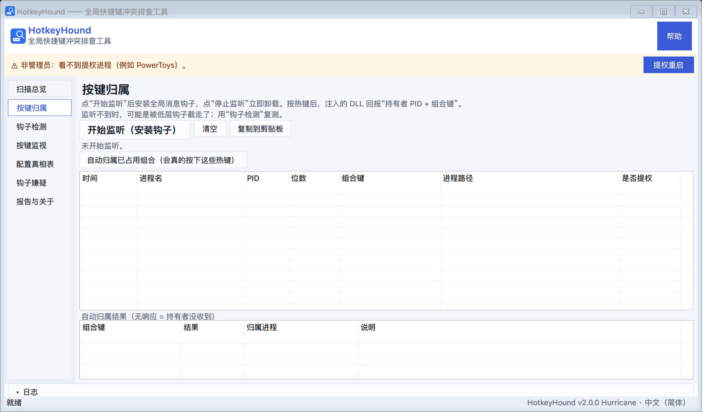
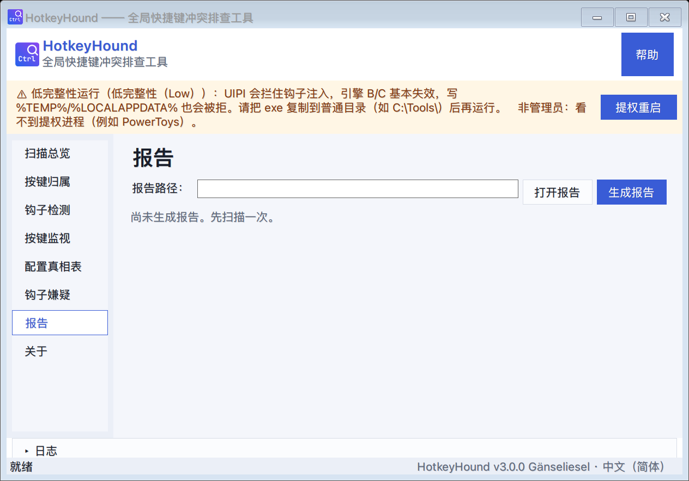
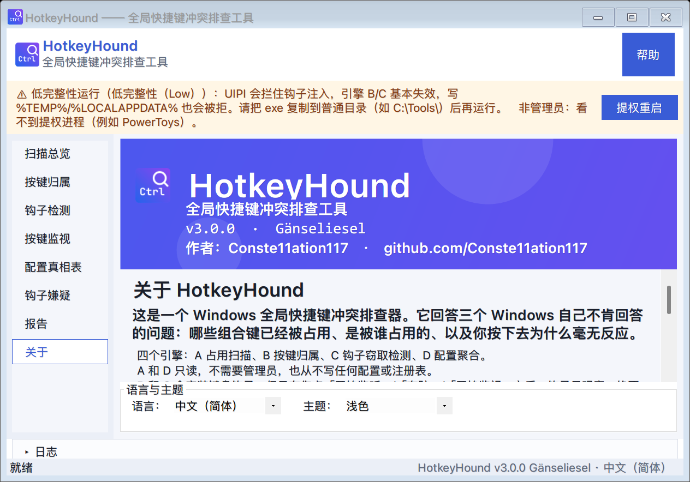

# HotkeyHound

A Windows tool that answers three questions Windows itself refuses to answer:

1. **Which key combinations are already taken?** — probes all ~1650 modifier × key combinations and lists the taken ones.
2. **Which process is holding one?** — you press the key; it reports which process received it.
3. **Why did my key do nothing at all?** — tells apart "swallowed before it reached the system" from "arrived, but was intercepted before the owner saw it".

Single `HotkeyHound.exe`, no installer, no .NET download (Windows 10/11 ships .NET Framework 4.8).
MIT licensed. *Co-developed with Kimi Code.* · **Landing page:** <https://conste11ation117.github.io/HotkeyHound/>



---

## 30-second start

1. Download `HotkeyHound.exe` from [Releases](../../releases) and double-click it. Nothing is installed.
2. **First launch asks for the interface language** — English by default, 中文 available; you can change it later on the Report & about page. The choice is stored in `%LOCALAPPDATA%\HotkeyHound\settings.ini`.
3. The app opens on **Scan overview**. Click **Start scan**. It takes a second or two: engine A probes ~1650 combinations, engine D reads the config files of known software.
4. On this machine the result is: **~220 combinations occupied**, **56 declared** in config files, **1651 rows** in the truth table. Yours will differ — that is the point of scanning.
5. **Report & about → Generate report** writes one self-contained HTML file you can send to someone else.

## "My shortcut does nothing." Which case am I in?

Find your symptom, open the page it names, and press the button it names. Every conclusion comes with its evidence printed next to it.

| What you observe | Page | What to click | What you get |
|---|---|---|---|
| The shortcut fires the wrong thing, or nothing, but **some app is clearly claiming it** | **Scan overview** → truth table | Start scan | The combination listed under *occupied*, with the declared owner if a config file names one |
| A specific key does nothing and you want to know **who receives it** | **Key attribution** | Start listening (installs hook), then press the key | Process name, PID, path, bitness, whether it runs elevated |
| The key produces **no trace at all** — not even an attribution | **Hook detection** | Arm (install hook), press the key, read the verdict | *Swallowed upstream* / *Likely intercepted* / *Not a global hotkey* / *Delivered* / *Inconclusive* when the prerequisites for a verdict are missing |
| Modifiers feel stuck, or a key types the wrong character | **Key monitor** | Start monitoring (installs keyboard hook), press the key | Which of the three input layers saw the key (raw input / low-level hook / this window), plus stuck modifiers, scancode remaps and keyboard filter drivers |
| "The scan says it's free, but pressing it still does something" | **Hook suspects** | (opens with the scan) | Software that implements shortcuts with a hook, an explicit evidence level for each, and the config path it was read from |

## What each page answers

| Page | The question it answers | Read-only? |
|---|---|---|
| **Scan overview** — occupancy scan | Which combinations are taken, and who declares them | Yes, no hooks |
| **Key attribution** — engine B | Which process received the hotkey I just pressed | Installs a hook on request |
| **Hook detection** — engine C | Was my key swallowed before the system, or intercepted after it | Installs a hook on request |
| **Key monitor** — input layers | Did raw input, the low-level hook and this window all see the key; are modifiers stuck | Installs a hook on request |
| **Config truth table** — engine A + D diff | Declared vs. measured, grouped by the five states | Yes, no hooks |
| **Hook suspects** — catalog + evidence | Which software eats keys through a hook, and how sure we are | Yes, no hooks |
| **Report & about** | Export everything as one HTML file; language, theme, version | Yes |

## Reading the truth table

Every row is one combination, in one of five states:

- **Declared = measured** — the config file and the probe agree; the software really holds it.
- **Declared, not registered** — the config says it exists, but nothing answered the probe: the software is not running, or it implements the shortcut with a hook. The row says which.
- **Occupied, undeclared** — something holds it and no readable config mentions it. Usually an input method, a chat app, or a driver.
- **System reserved** — Windows itself owns it (Alt+F4, Alt+Tab, Win+L, …). The row says this is Windows behaviour, not a third-party app.
- **Free, undeclared** — safe to claim; the report lists concrete candidate combinations that do not collide.

Above that sits the **hook-suspect catalog**: software whose shortcuts never call `RegisterHotKey` (PowerToys Keyboard Manager, input methods, QQ/WeChat, AutoHotkey scripts, vendor control centres, screen-mirroring tools). Its config is read where possible, its process is checked, and the row carries an explicit evidence level — *Confirmed* / *Highly suspected* / *Known default* / *Reference only* — plus the config path that produced it. **A guess is never printed as a fact.**

## Command line

```
HotkeyHound.exe                                   # graphical interface
HotkeyHound.exe --scan --report out.html          # engines A + D, HTML report
HotkeyHound.exe --listen --seconds 60             # attribution console (engine B)
HotkeyHound.exe --lang en --scan --report en.html # English output
HotkeyHound.exe --elevate --listen                # restart as administrator, then listen
HotkeyHound.exe --selftest                        # self-test (installs hooks; see safety)
HotkeyHound.exe --monitor --seconds 10            # key monitor: raw input / hook / window layers
HotkeyHound.exe --selftest --no-hooks             # self-test without touching hooks
HotkeyHound.exe --attribute-all --dry-run         # plan a batch attribution, press nothing
HotkeyHound.exe --attribute-all --yes             # press each occupied hotkey, record the owner
```

## The four engines

| Engine | What it does | Installs a hook? | Needs admin? |
|---|---|---|---|
| **A — Occupancy scan** | Probes every modifier × key combination (~1650) with `RegisterHotKey` and reports which are taken. Successful registrations are released immediately, so the scan has no side effects. | No | No |
| **B — Key attribution** | Installs a global message hook; when a hotkey owner receives its command, the injected DLL reports *which process* received it. | **Yes** | Recommended |
| **C — Hook-swallow detection** | Installs a low-level keyboard hook and judges whether your key never reached the system, reached it but was intercepted, or arrived normally. When its prerequisites are missing (engine B not listening, scan not finished) it says *Inconclusive* instead of guessing. | **Yes** | Recommended |
| **D — Config aggregation** | Reads hotkey settings from software that stores them in plain files (PowerToys, Everything, OBS, NVIDIA ShadowPlay registry, Wallpaper Engine, MSI Afterburner) and diffs them against the measured results. | No | No |

On 32-bit processes: Windows only lets a hook inject into processes of the same bitness, so HotkeyHound ships a small 32-bit companion process that installs a 32-bit hook. Both report into the same table, and each row says which bitness it came from.

## Safety model

This tool touches input handling, so its behaviour is deliberately narrow:

- **Engine A and D never install anything.** They register hotkeys and release them in the same instant; they read configuration files. They never write configuration or the registry.
- **Engines B and C install hooks only when you explicitly ask.** The pages say so in plain language, and the buttons are labelled with *（安装钩子）* / *(installs a hook)*. Loading the application installs nothing.
- **Hooks never swallow keys.** The hook procedures observe and pass everything through (`CallNextHookEx`); the tool does not remap, block, or delay input.
- **The tool never ends, suspends, or modifies other processes.** The "comparison" workflow only records observations and asks you to quit a suspect application yourself.
- **No network code at all.** Nothing leaves the machine.

### About the injected DLL, and an incident worth disclosing

Engine B works by installing a global `WH_GETMESSAGE` hook, which means Windows loads a small native DLL into every process in your session. During development, an early build passed a **.NET managed delegate** where the hook procedure was expected. The address of that delegate is only valid inside our own process; once injected elsewhere it is a wild pointer, and the result was every GUI process crashing at once (`0xc0000409`, faulting module `unknown`) — a machine-wide crash.

The fix (locating the native export with `GetProcAddress` and passing *that* pointer) plus the hardening applied afterwards — an empty `DllMain`, one-shot initialisation instead of a critical section on the hot path, no allocation inside the hook procedure — were verified on a real machine: hooks installed and uninstalled repeatedly, **zero crash events**, and a genuine attribution (`Win+R → explorer.exe`) captured end to end. The incident is documented in the changelog rather than quietly dropped, because anyone auditing a hook-based tool deserves to know its history.

After a hook session, a copy of the DLL stays loaded in processes that were injected until those processes exit; a reboot clears it. The tool tells you this in the interface.

## Known limitations

- **Elevated processes need HotkeyHound running as administrator.** Otherwise their hotkeys are attributed to nobody. The interface explains this and offers a one-click restart as administrator.
- **Hook-based hotkeys are invisible to the occupancy scan** (they never call `RegisterHotKey`). That is precisely why engines B and C exist; the report always prints this caveat.
- **A 32-bit process is covered, but only while its companion host is alive** — if the 32-bit helper fails to start, that row is missing and the log says why.
- Probes are **per session**: hotkeys registered in another logon session are not visible.
- Verification was done on Windows 11 26100 and Windows 10 19045; other versions should work but have not been tested.
- Hook-based and in-app shortcuts **cannot be listed** — Windows keeps them out of every table it has. A tool that claims otherwise is guessing.

## Build from source

The build is deliberately dependency-free: the development machine has **no .NET SDK**, so the project compiles straight from the Visual Studio toolchain.

```
powershell -ExecutionPolicy Bypass -File build.ps1
```

`build.ps1` compiles the native hook DLL with MSVC (`cl /LD /MT`), then compiles the C# sources with the Roslyn `csc.exe` that ships with Visual Studio (.NET Framework 4.8, `-langversion:7.3`, `-nostdlib+` with explicit runtime references), and embeds the DLL as a resource. Output: `dist\HotkeyHound.exe`, a single file. No NuGet packages, no downloads.

Layout:

```
src\Program.cs            entry point, CLI parsing
src\Core\                 engines, models, report builder, settings
src\Core\Adapters\        per-software config readers (engine D)
src\Ui\                   WinForms pages
src\Hook\HookDll.cpp      native hook DLL (engine B)
tests\SelfTest.cs         T1–T10, driven by --selftest
docs\                     help documents (Chinese and English)
```

## How it compares

Four tools in this space are alive today, and they answer different questions. This table is meant to be honest — where a competitor does something better, it says so.

| | HotkeyScan | Hotkey Screener | Hotkey Detective | **HotkeyHound** |
|---|---|---|---|---|
| Enumerate occupied combinations | 761 | lists registered hotkeys | — | **1650** |
| Name the owner of a registered hotkey | infers it from what changes on screen | global hook + synthetic press | global hook, you press | **global hook, you press — or an opt-in batch press** |
| Keys eaten by a **keyboard hook** | only when the press causes something visible | documented blind spot | documented blind spot | **dedicated detector + config catalog, with evidence levels** |
| Explain *why* a combination is taken | reads PowerToys / ShareX / OBS / AHK configs | — | — | **reads six app families, and prints the config path it used** |
| Key monitor (stuck modifiers, remaps, filter drivers) | yes | — | — | **yes (1.2.0)** |
| 32-bit processes | 64-bit only | **32 + 64** | ships x86 and x64 | **x64 + x86 (since 1.3.0)** |
| Report you can hand to someone | — | — | — | **self-contained HTML, bilingual** |
| Licence | MIT | closed source | GPL-3.0 | MIT |

In practice: **HotkeyScan is the closest peer** — its key monitor is why we built ours, and since 1.2.0 we match it and add hook-suspect evidence on top. **Hotkey Screener is the most direct attributor for registered hotkeys**, and **HotkeyHound is the one that separates the three reasons a shortcut does nothing** — claimed by a registration, eaten by a hook before it ever reaches the system, or simply not a global shortcut at all — and shows its evidence for every conclusion instead of asserting one.

Older options exist too — NirSoft's HotKeysList (lists registrations, names no owners, listed up to Windows 8) and kernel-level anti-rootkit tools like PCHunter or OpenArk, which can read win32k's hotkey table but need an unsigned driver, are blocked by Secure Boot / HVCI on current Windows, and still cannot see hooks.

## Screenshots

<p align="center">
  
  
  
  
  
  
  
  
</p>

## Documentation

- [`docs/help.zh-CN.md`](docs/help.zh-CN.md) / [`docs/help.en-US.md`](docs/help.en-US.md) — in-depth guides: what each engine does, how to read the report, how to chase a "key does nothing" problem, permissions and integrity levels, troubleshooting.
- [`docs/faq.en-US.md`](docs/faq.en-US.md) — the questions people actually ask before trying this ("the scan says it's free but my shortcut still does nothing", "why can't Windows just tell me", "does it need admin", "does it record my keystrokes").
- [`docs/code-review.md`](docs/code-review.md) — the audit behind the safety claims: what was checked, what was found, what was fixed, and the risks that were accepted with reasons.
- [`CHANGELOG.md`](CHANGELOG.md) — version history.
- In the application: press **F1**.

## License

[MIT](LICENSE) © 2026 @Conste11ation117
